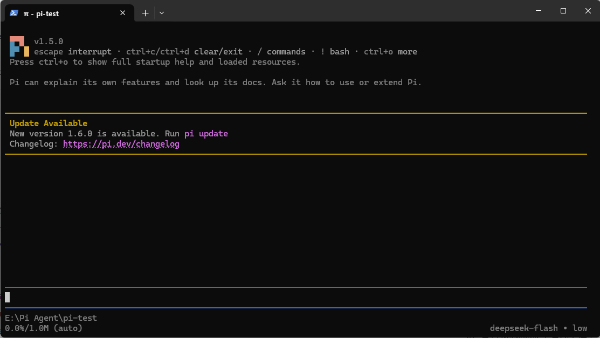
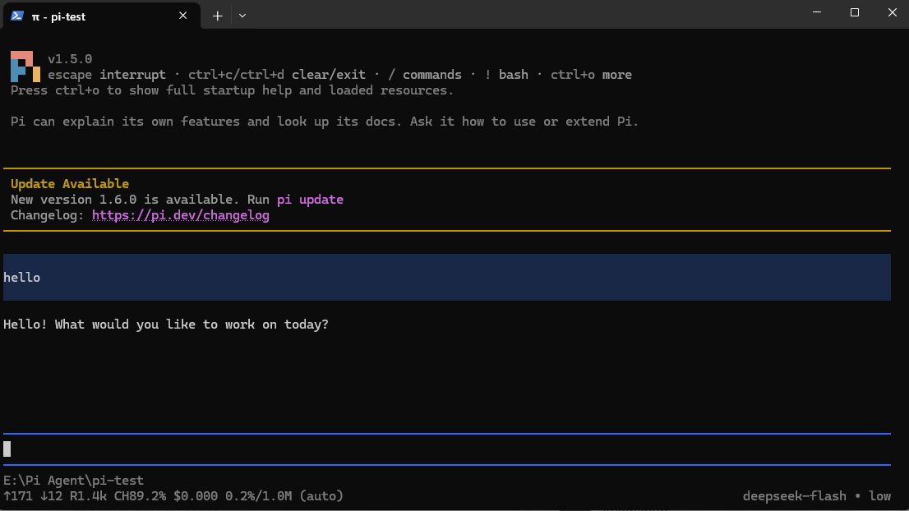
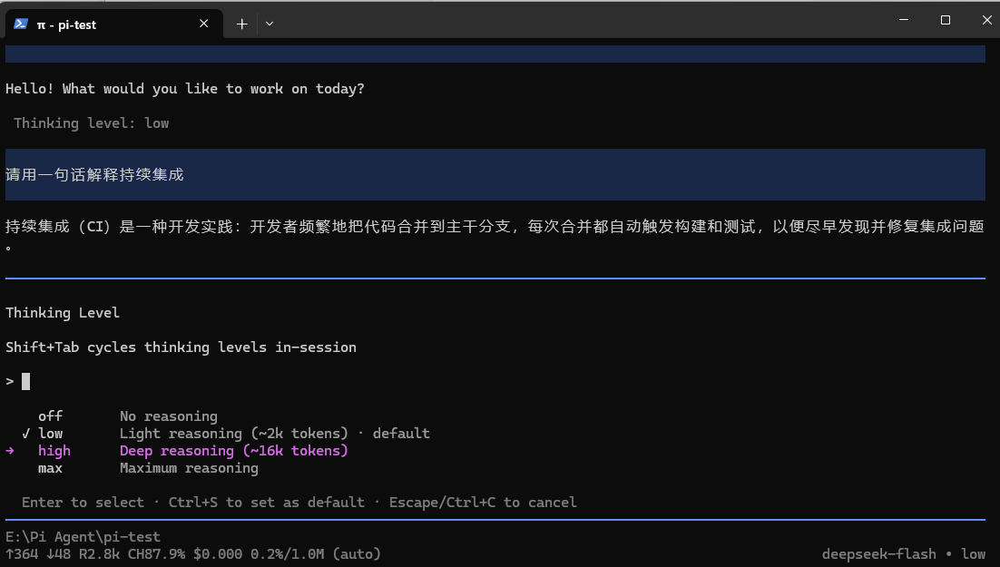
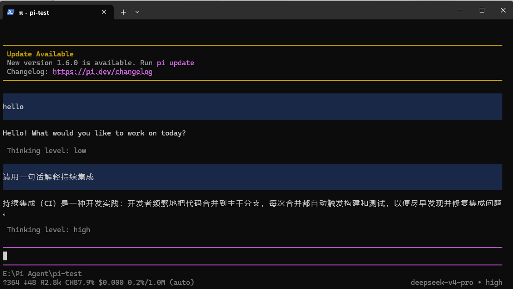
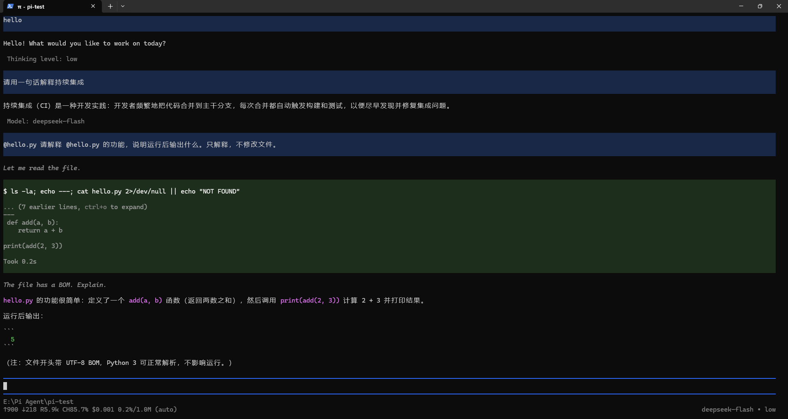
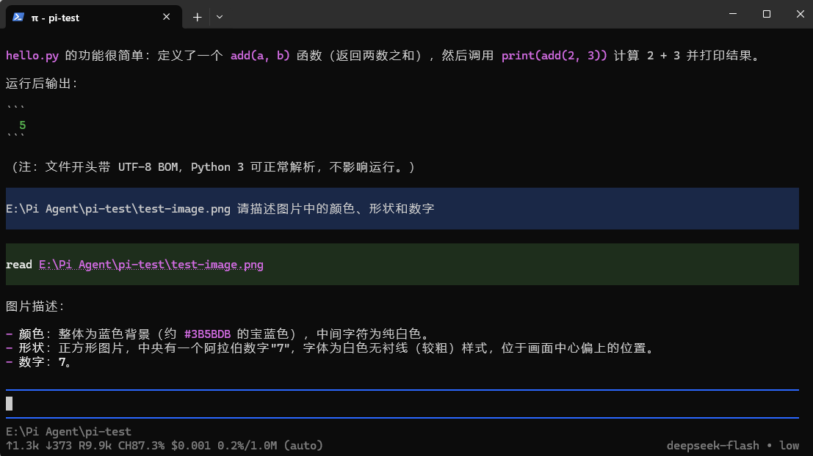
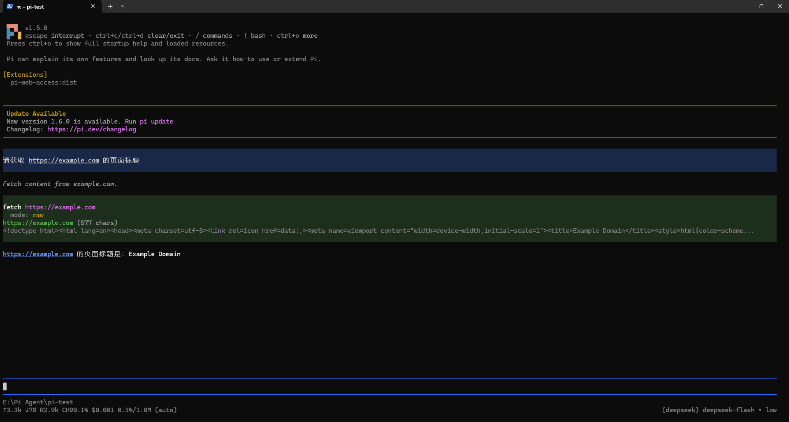
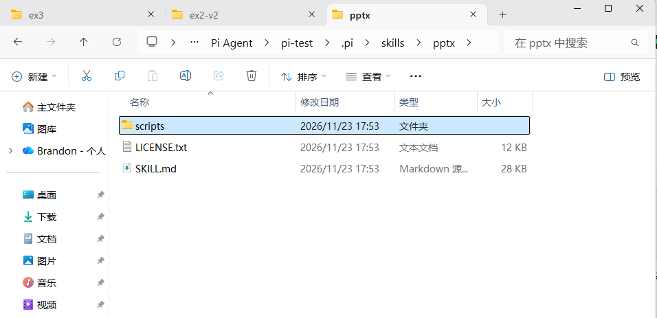
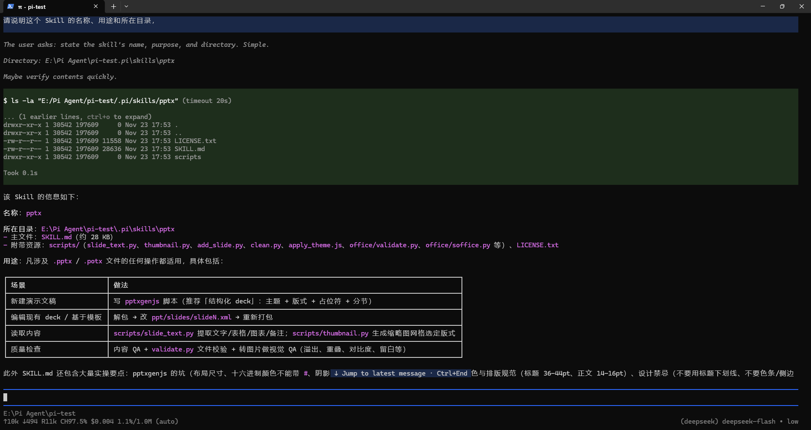

# 实践课1：Pi Agent 安装与使用

> 环境：Windows PowerShell · Pi 1.5.0 · Node.js v24.18.0 · npm 11.16.0 · Git 2.55.0
> 练习目录：`E:\Pi Agent\pi-test`
> 模型配置：DeepSeek（API Key 方式，`pi auth check` 返回 ready）

## 任务一 本地安装并启动

1. 使用官方安装器安装（PowerShell 执行）：

```powershell
powershell -c "irm https://pi.dev/install.ps1 | iex"
```

2. 安装完成后重新打开终端，在专用练习文件夹启动：

```powershell
cd "E:\Pi Agent\pi-test"
pi
```

启动界面显示版本号 1.5.0、当前工作目录 `E:\Pi Agent\pi-test`，底部状态栏显示当前模型 `deepseek-flash · low`，证明客户端已成功启动。



*图 S1 Pi 1.5.0 启动界面（版本、工作目录、模型状态可见）*

## 任务二 配置模型并完成一次会话

1. 在 Pi 中输入 `/login`，选择 **Sign in with an API key**，搜索并选择 DeepSeek，粘贴个人 API Key 提交。配置写入 `~/.pi/agent/auth.json`，`pi auth check --provider deepseek --model deepseek-flash` 返回 `ready`。
2. 发送最简单的会话：输入 `hello`，模型立即回复，会话链路正常。



*图 S2 发送 hello 后收到模型回复，配置生效*

## 任务三 切换模型与思考级别

1. **思考级别切换（切换前 low → 切换后 high）**：按 Shift+Tab 打开 Thinking Level 选择器，从 `low`（Light reasoning ~2k tokens）切换为 `high`（Deep reasoning ~16k tokens），回车确认。
2. **模型切换（切换前 deepseek-flash → 切换后 deepseek-v4-pro）**：通过模型选择器把模型切换为 `deepseek-v4-pro`，切换后发送短问题仍正常回复。

选择说明：简单问答用低思考级别即可，响应快、用量省；复杂推理/代码任务用 `high` + 更强模型，但会增加等待时间和 token 消耗。



*图 S3 思考级别选择器（low → high）*



*图 S4 底部状态栏变为 deepseek-v4-pro · high，切换生效*

## 任务四A 使用 @ 引用代码文件

1. 在 pi-test 文件夹创建 `hello.py`：

```python
def add(a, b):
    return a + b

print(add(2, 3))
```

2. 在 Pi 输入 `@`，候选列表中选择 `hello.py`，继续输入提示词发送："请解释 @hello.py 的功能，说明运行后输出什么。只解释，不修改文件。"
3. Pi 正确解释了 `add` 函数（返回两数之和），并给出运行输出为 `5`，与预期一致。



*图 S5 @hello.py 引用成功，回复解释函数并给出输出 5*

## 任务四B 粘贴小图片并测试

1. 准备一张 200×200 测试图片（蓝色方块 + 白色数字 7）：`test-image.png`。
2. 在支持图片输入的模型下，在 Pi 输入区用 Ctrl+V 粘贴图片，输入区出现图片附件提示后发送："请描述图片中的颜色、形状和数字。"
3. Pi 正确识别：颜色为蓝色、形状为正方形、数字为 7，三项全部正确。



*图 S6 粘贴 test-image.png 后，Pi 正确识别蓝色正方形和数字 7*

## 任务五 安装并使用一个插件

1. **选型**：在 https://pi.dev/packages 选择 `pi-web-access`（给 Pi 增加网页抓取工具）。npm 来源：https://www.npmjs.com/package/pi-web-access
2. **安装**（用户级安装）：

```powershell
pi install npm:pi-web-access
```

3. **加载验证**：完全退出 Pi 后重新运行 `pi`，启动画面 `[Extensions]` 区域出现 `pi-web-access/dist`，证明插件已加载。
4. **功能试用**：发送"请获取 https://example.com 的页面标题"，Pi 调用插件提供的网页抓取工具，成功返回标题 `Example Domain`。



*图 S7 重启后 [Extensions] 显示 pi-web-access/dist，且网页抓取调用成功*

## 任务六 让 AI 安装一个 PPT Skill（选做）

1. **下载安装**：从 https://github.com/anthropics/skills 下载 `skills/pptx` 完整目录到当前项目的 `.pi/skills/pptx`，保留 SKILL.md、LICENSE.txt 和 scripts 等支持文件。源 commit：`e4bb5d960d87126ff3b3a8af1a104b7db67560ba`（main 分支 HEAD，2026-11-16）。

目录结构：

```text
E:\Pi Agent\pi-test\
└─ .pi\
   └─ skills\
      └─ pptx\
         ├─ SKILL.md
         ├─ LICENSE.txt
         └─ scripts\
            ├─ add_slide.py / clean.py / slide_text.py / thumbnail.py / apply_theme.js
            └─ office\ (helpers\, schemas\, validators\, soffice.py, validate.py)
```

2. **启动发现**：完全退出 Pi 后在 pi-test 目录重新启动，Pi 自动发现项目 `.pi/skills` 下的 pptx Skill。



*图 S8 重新启动 Pi 后，pptx Skill 被自动发现*

3. **调用验证**：让 Pi 说明该 Skill 的名称、用途和所在目录，回复确认：
   - 名称：`pptx`
   - 用途：覆盖 `.pptx`/`.potx` 的创建（pptxgenjs）、读取（slide_text.py / thumbnail.py）、编辑（解包改 XML 再打包）、校验（office/validate.py）等
   - 所在目录：`E:\Pi Agent\pi-test\.pi\skills\pptx`（与安装位置一致）



*图 S9 调用 pptx Skill，回复包含名称、用途与安装目录*

## 小结

| 任务 | 截图 | 结果 |
|------|------|------|
| 一 安装启动 | S1 | Pi 1.5.0 启动成功 |
| 二 配置模型与会话 | S2 | DeepSeek API Key 配置，会话正常 |
| 三 切换模型/思考级别 | S3、S4 | flash→v4-pro，low→high |
| 四A @ 引用文件 | S5 | 解释 add 函数，输出 5 |
| 四B 粘贴图片 | S6 | 识别蓝方块+数字 7 |
| 五 插件 | S7 | pi-web-access 安装、加载、抓取成功 |
| 六 PPT Skill（选做） | S8、S9 | 安装、发现、调用三层全部通过 |
