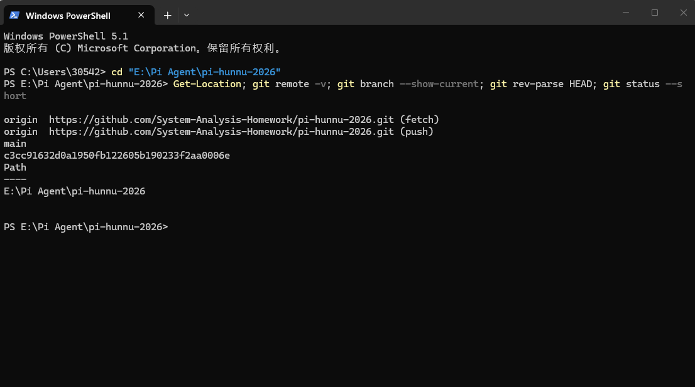
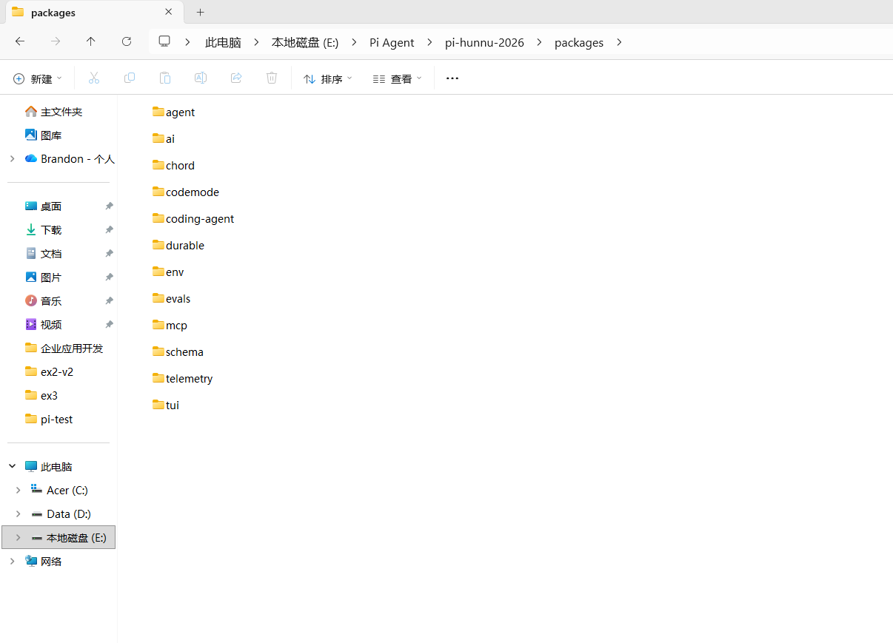
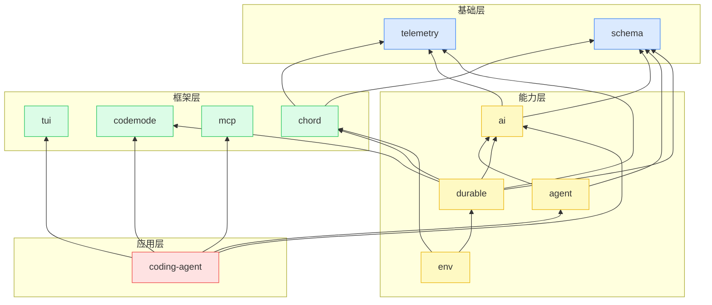

# 实践课2：组织建仓与源码分析

> 本人重点分析的模块：**mcp、codemode**（其余模块为通读，依赖结论均以实际代码为准）。

## 源码获取

- 小组组织仓库（组长完成 fork）：`https://github.com/System-Analysis-Homework/pi-hunnu-2026`
- 实际 clone 地址（提交 Issue 时以文本 URL 形式粘贴）：
  ```
  https://github.com/System-Analysis-Homework/pi-hunnu-2026.git
  ```
- clone 命令：
  ```bash
  git clone --branch main https://github.com/System-Analysis-Homework/pi-hunnu-2026.git pi-hunnu-2026
  cd pi-hunnu-2026
  ```

### 本地仓库信息（对应截图 S1）

| 检查项 | 结果 |
|--------|------|
| 当前目录 | `E:\Pi Agent\pi-hunnu-2026`（全英文路径） |
| `git remote -v` | `origin  https://github.com/System-Analysis-Homework/pi-hunnu-2026.git (fetch/push)` |
| 分支 | `main` |
| 完整提交编号 | `c3cc91632d0a1950fb122605b190233f2aa0006e` |
| `git status --short` | 空输出（工作区干净） |



### 源码目录结构

仓库为 npm workspaces 单仓（monorepo），`package.json` 的 `workspaces` 为 `packages/*` 与 `apps/*`。文档表格中的 11 个子模块全部位于 `packages/` 下，另有课程后续开发用的 `apps/`（p2、p2-mac、p3）与 `packages/evals`，属于文档表格之外的额外目录，已如实说明差异：

```
pi-hunnu-2026/
├─ package.json          # 根工作区：build 脚本串联 11 个 packages 的构建
├─ scripts/              # 构建/检查辅助脚本（bundle、包文件清理等）
├─ packages/
│  ├─ telemetry  schema  chord  tui  codemode  mcp
│  ├─ ai  durable  env  agent  coding-agent
│  └─ evals             # 表格外：评测包
└─ apps/                # 表格外：课程实践应用 p2、p2-mac、p3
```



## 构建顺序

根 `package.json` 的 `npm run build` 用一条 `cd` 链串行构建 11 个包，顺序为：

```
telemetry → schema → chord → tui → codemode → mcp → ai → durable → env → agent → coding-agent
```

- `build:offline` 与 `build` 唯一差别是 `ai` 一环改用 `build:offline`（跳过 `generate-models` 联网生成模型目录）。
- 除 `ai`（先生成模型目录再 `tsc`）和 `coding-agent`（`tsc` 后用 esbuild 打包出单文件 `dist/bundle/cli.js`）外，其余 9 个包的 build 都是 `tsc -p tsconfig.build.json`，把 `src/*.ts` 编译到 `dist/`。

## 模块分析表

| 子文件夹 | 代码主要实现什么功能 | 本模块 build 执行什么、生成什么 | 直接依赖哪些内部模块 | 依据文件或代码位置 |
|----------|----------------------|--------------------------------|----------------------|--------------------|
| telemetry | 厂商中立的遥测契约与类型化工具：metrics、memory 渲染、noop 实现，供各包统一上报口径 | `tsc` 编译 `src/{index,metrics,memory,noop,render}.ts` → `dist/index.js` | 无（依赖链最底端） | `packages/telemetry/package.json`；`src/index.ts` |
| schema | 无 `eval` 的 JSON Schema 构建器与校验器：schema 编译一次成闭包，负责值校验、coerce、报错说明 | `tsc` → `dist/index.js` | 无 | `packages/schema/src/compiler.ts`、`validator.ts`；`README.md` 首段 |
| chord | 用"可跨进程存活、支持插件热重载的对象"搭应用：host、contracts、remote、sqlite 存储等 | `tsc` → `dist/index.js` | pi-schema、pi-telemetry | `packages/chord/package.json` dependencies；`src/store`、`src/remote` |
| tui | 极简终端 UI 框架：差分渲染、同步输出防闪烁、按键绑定、编辑器组件；含各平台原生加速模块 | `tsc` → `dist/index.js`；另有按平台的 `build:native:win32/darwin/linux` 编译原生扩展 | 无 | `packages/tui/src/tui.ts`、`layout.ts`；根 `package.json` `build:native:*` |
| codemode | 在 QuickJS(WASM) 沙箱里运行模型生成的 JS，唯一能力是调用注入的 tools，嵌套工具调用不回灌 LLM 上下文；Node/Bun 与 Cloudflare Workers 双环境 | `tsc` → `dist/index.js`（含 `dist/portable.js` 子路径导出） | 无（README 明确"no pi dependencies"） | `packages/codemode/src/runtime`、`wasm.ts`；`README.md` 首段 ⭐重点分析 |
| mcp | 独立的 MCP 客户端：transport-neutral 客户端核心 + stdio / Streamable HTTP / 内存三种传输，负责请求关联、超时、取消、OAuth | `tsc` → `dist/index.js`；运行时仅依赖 `cross-spawn` | 无（不依赖官方 MCP SDK 或其他 pi 包） | `packages/mcp/src/client.ts`、`transports/`；`README.md` 首段 ⭐重点分析 |
| ai | 统一 LLM API：provider 集合、自动认证解析（API key/OAuth）、token 与成本统计、会话上下文持久化与中途换模型 | `generate-models`（catalog/generate.ts --strict 生成 `models.generated.ts`）→ `check:model-data` → `tsc` → 复制 `src/providers/data` 到 `dist/providers`；`build:offline` 跳过联网生成步骤 | pi-schema、pi-telemetry | `packages/ai/package.json` scripts；`src/providers/`、`src/auth/` |
| durable | 实验性持久执行层：tasks、timers、signals、session、storage(store/documents)，把 agent 的状态与工具放到可恢复的存储上 | `tsc` → `dist/index.js` | chord、pi-ai、pi-codemode、pi-schema、pi-telemetry | `packages/durable/package.json` dependencies；`src/store/`、`src/tasks.ts` |
| env | 为 Pi Durable 提供远程执行环境：agent 工具在另一台机器（通常 SSH）上运行，含连接、进程、文件列表、watch | `tsc` → `dist/index.js` | chord、pi-durable | `packages/env/package.json` dependencies；`src/ssh.ts`、`remote-env.ts` |
| agent | 有状态 agent 核心：agent-loop（工具执行循环）与事件流，建立在 pi-ai 之上 | `tsc` → `dist/index.js` | pi-ai、pi-schema | `packages/agent/src/agent-loop.ts`、`agent.ts`；`README.md` 首段 |
| coding-agent | 终端编码 agent（即 `pi` 命令）：CLI、配置、TUI 模式、扩展系统，组装上述所有包 | `build:unbundled`（`tsc` + 把 `cli.js`/`rpc-entry.js` 变成可执行 + copy-assets）→ esbuild 打包出单文件 `dist/bundle/cli.js` | pi-agent-core、pi-ai、pi-codemode、pi-mcp、pi-tui（运行依赖）；src 内还 import pi-coding-agent 自身入口（rpc 复用） | `packages/coding-agent/package.json` scripts；`../../scripts/build-coding-agent-bundle.mjs` |

> 注：`tui` 的原生扩展编译（`build:native:*`）是可选的平台加速件，属可选构建产物；`ai` 的 `generate-models` 需要联网拉取模型数据，离线场景用 `build:offline`，两者在图中已区分。

## 模块层级与依赖关系图

层级划分依据（自底向上）：
1. **基础层**：无内部依赖的 telemetry、schema，被所有上层引用；
2. **框架层**：tui（纯 UI）、codemode（纯沙箱）、mcp（纯协议客户端）、chord（对象/进程框架）——彼此不依赖，只在更高层被组装；
3. **能力层**：ai（模型调用，基于 schema/telemetry）、durable（持久执行，基于 chord/ai/codemode）、env（远程执行，基于 chord/durable）、agent（agent 循环，基于 ai）；
4. **应用层**：coding-agent 组装全部能力，对外提供 `pi` CLI。

箭头方向统一为"使用方 → 被依赖方"。



可编辑图源见 [dependency-graph.mmd](./dependency-graph.mmd)（纯 Mermaid 文本，可粘贴到 mermaid.live / draw.io / Typora 编辑）。

### 重点模块：mcp 与 codemode

- **mcp**（`@earendil-works/pi-mcp`）：`src/client.ts` 实现与传输无关的 MCP 客户端核心（请求关联、初始化握手、超时、取消、服务端请求处理），`src/transports/` 提供 stdio（`cross-spawn` 拉起子进程）、Streamable HTTP（可注入 fetch 走代理）与内存测试传输，`src/oauth/` 处理授权。它是 coding-agent 接入外部 MCP 服务器（tools/plugins）的唯一通道。
- **codemode**（`@earendil-works/pi-codemode`）：`src/runtime/` 把模型生成的 JS 放进 QuickJS-WASM 沙箱执行，脚本只能调用注入的 `tools`/`ALL_TOOLS`/`text`/`image`/`exit` 等能力；Node/Bun 下每个执行跑在独立 worker thread（`CodemodeSandbox`），Cloudflare 下跑在 Durable Object（`dist/portable.js`）。durable 的 `src/codemode/` 与 coding-agent 的内置 `codemode` 工具都基于它。
- 两者共同点：都是"零 pi 依赖"的独立包，位于依赖图第二层，被上层直接组装；差异：mcp 向外连接服务、codemode 向内隔离执行，一外一内构成 agent 与外界交互的两条边。

## 问题回答

### 1. 根目录与子模块中的 `npm run build` 分别读取什么配置、执行什么工作？

- 根目录 `build`：读取根 `package.json` 的 `workspaces`（`packages/*`、`apps/*`）与 `scripts.build`，本质是一条 `cd packages/<x> && npm run build && cd ../<y> …` 的**串行 shell 链**，按固定顺序调用 11 个子包各自的 build；不读取任何子包配置，顺序硬编码在根脚本里。另有 `build:offline`（ai 走离线分支）与 `build:native:<platform>`（只编译 tui 原生加速件）。
- 子模块 `build`：读取各自 `tsconfig.build.json`（继承根 `tsconfig.base.json`，指定 `src` → `dist`、ESM 等），绝大多数执行 `tsc -p tsconfig.build.json` 编译 TypeScript。两个特例：
  - `ai`：`build` = `generate-models && build:offline`，即先用 `catalog/generate.ts --strict` 生成 `src/models.generated.ts` 模型目录，再 `check:model-data && tsc && package-files.mjs copy src/providers/data dist/providers`；
  - `coding-agent`：`build` = `build:unbundled && node ../../scripts/build-coding-agent-bundle.mjs`，先 `tsc` 出普通 `dist/`，再用 esbuild 把入口打成自包含单文件 `dist/bundle/cli.js`（脚本中用 banner 注入 `createRequire`，并维护 `allowedExternalPackages` 白名单排除可选原生依赖）。

### 2. 构建顺序和模块依赖有什么关系？相邻构建的模块是否一定互相依赖？

- **关系**：构建顺序是依赖关系的**拓扑序**——被依赖者先建。`telemetry`、`schema` 位于链首，因为 chord/ai/agent/durable 都 import 它们；`coding-agent` 压轴，因为它组装其余 10 个包；`durable` 在 `codemode` 之后，因为 durable 直接 import `@earendil-works/pi-codemode`。
- **相邻不一定互相依赖**。链条里的 `chord → tui → codemode → mcp` 连续四包两两之间**没有任何 import 关系**（tui/codemode/mcp 是零内部依赖的独立包）。它们排在链中只是根脚本硬编码的线性顺序需要给每个包一个位置，与依赖无关。真正的硬约束只有"使用者的 build 不能先于被依赖者的 build"，线性链是拓扑序的一种可行排列，但不是最小依赖链。

### 3. 选择一条涉及至少三个模块的依赖路径，说明这些模块如何分工。

选取本人重点分析的路径：**coding-agent → codemode → （QuickJS-WASM 沙箱）**，以及对照路径 **coding-agent → mcp → （外部 MCP 服务器）**；再取一条三层内部依赖路径 **agent → ai → schema** 说明分层分工：

- **agent → ai → schema**：`agent`（`src/agent-loop.ts`）负责"何时调模型、何时执行工具"的有状态循环与事件流，不含任何具体模型协议；`ai`（`src/providers/`、`src/auth/`）负责把一次对话请求翻译成具体 provider 的 API 调用，处理认证、计费统计、流式响应；`schema`（`src/validator.ts`）为 ai 的工具参数与结构化输出提供无 `eval` 的 JSON Schema 编译与校验闭包。三层各司其职：循环控制 / 协议适配 / 数据契约校验，上层只 import 下层的公开入口（`dist/index.js`），因此任意一层可单独替换（例如换 provider 不动 agent-loop）。

## 总结

- 文档表格 11 个子模块在仓库中实际位置为 `packages/` 下，构建由根 `package.json` 串行驱动，顺序为拓扑序但相邻项未必有依赖；
- 依赖图呈四层：基础（telemetry/schema）→ 框架（chord/tui/codemode/mcp）→ 能力（ai/durable/env/agent）→ 应用（coding-agent）；
- 重点分析确认：mcp 与 codemode 是两个零内部依赖、可独立复用的边界包，分别负责"对外连接"与"对内沙箱执行"。
