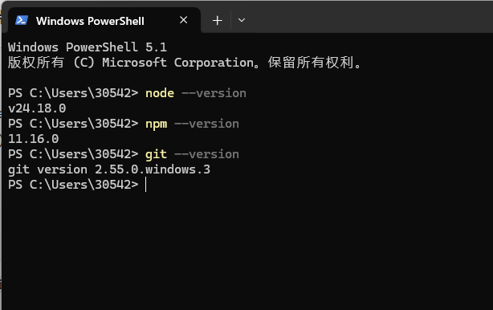
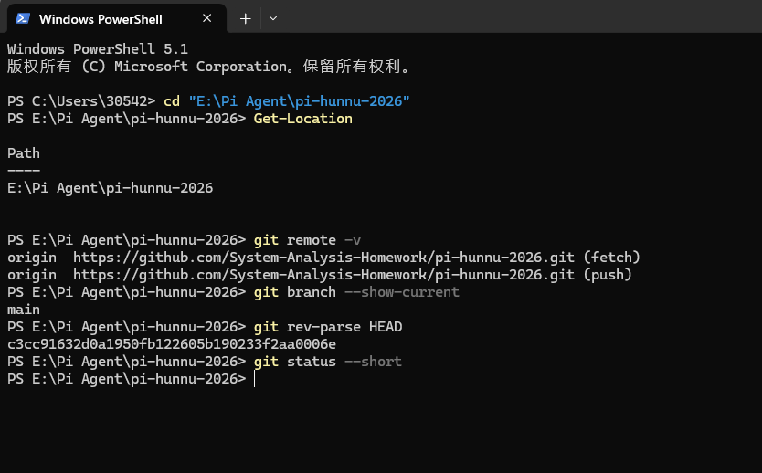
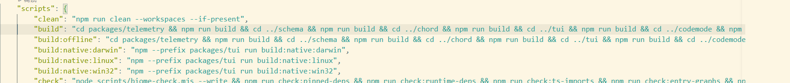
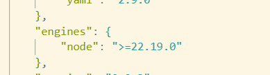
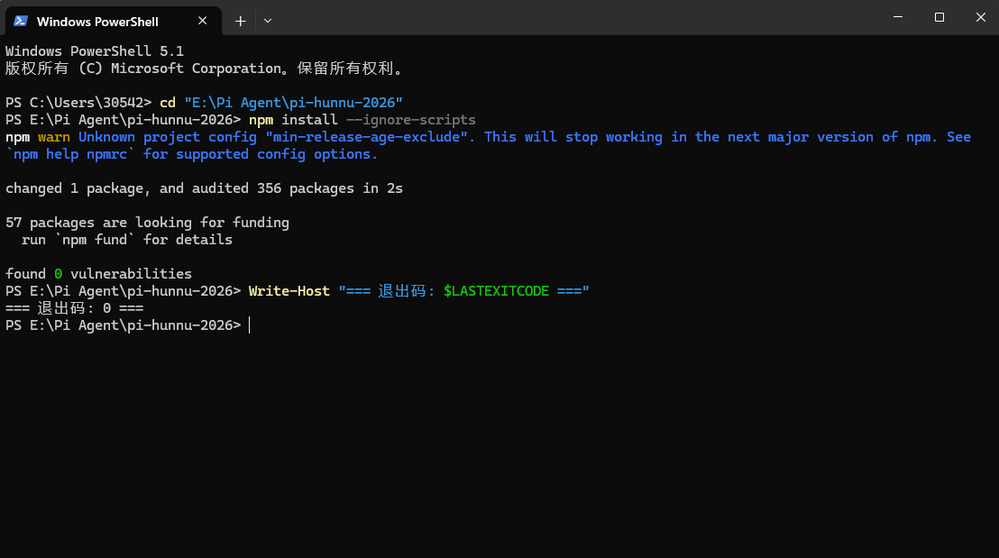
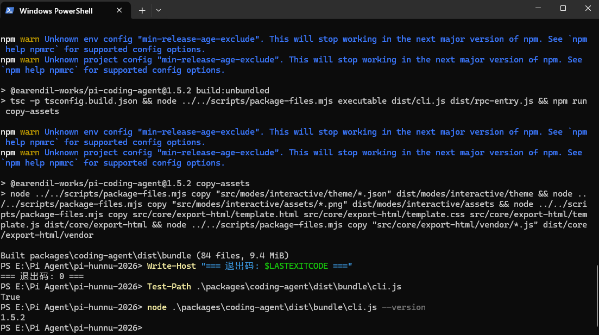
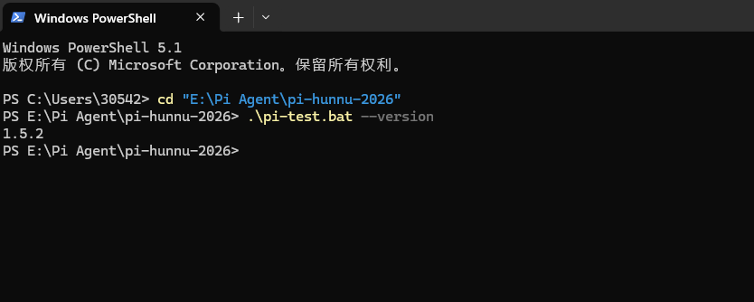
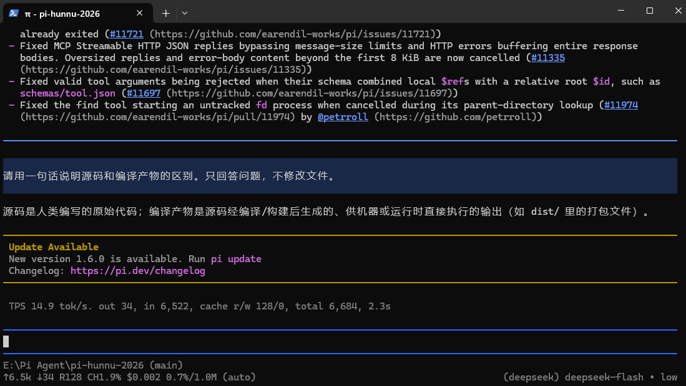

# 实践课3：Pi Agent 源码安装与编译

> 使用第二次实践课已 clone 的小组组织仓库源码（`System-Analysis-Homework/pi-hunnu-2026`）。

## 任务一 实验准备：检查和安装开发工具

在 PowerShell 中逐条执行版本检查命令：

```powershell
node --version    # v24.18.0
npm --version     # 11.16.0
git --version     # git version 2.55.0.windows.3
```

| 工具 | 实际版本 | 是否满足要求 |
|------|----------|--------------|
| Node.js | v24.18.0 | ✅ 满足根项目 `engines.node >=22.19.0`，且为课程建议的 24 LTS 系列 |
| npm | 11.16.0 | ✅ Node.js 24 附带的 npm，按实际版本记录 |
| Git for Windows | 2.55.0.windows.3 | ✅ |
| 文本编辑器 | VS Code | ✅ |

环境使用 `.msi` 安装官方 Node.js（未使用 fnm），因此跳过文档中的 fnm 切换小节。



## 任务二 下载课程仓库源码

复用第二次实践课已下载的小组组织仓库，重新执行检查命令确认源码来源与版本：

```powershell
cd "E:\Pi Agent\pi-hunnu-2026"
Get-Location            # E:\Pi Agent\pi-hunnu-2026（全英文路径）
git remote -v           # origin https://github.com/System-Analysis-Homework/pi-hunnu-2026.git
git branch --show-current  # main
git rev-parse HEAD      # c3cc91632d0a1950fb122605b190233f2aa0006e
git status --short      # 空输出，工作区干净
```



## 任务三 阅读配置，确认安装与编译的依据

打开仓库根 `package.json` 观察关键字段：

- `engines.node` 声明为 `"node": ">=22.19.0"`（第 69~71 行）；
- `scripts.build` 是一条以 `&&` 串联的长命令：`cd packages/telemetry && npm run build && cd ../schema && ... && cd ../coding-agent && npm run build`，依次进入 telemetry、schema、chord、tui、codemode、mcp、ai、durable、env、agent、coding-agent 共 11 个子包执行各包自己的 build；
- `workspaces` 为 `packages/*`、`apps/*` 与若干 examples 目录，是 npm workspaces 单仓；
- `packages/coding-agent/package.json` 中有 `bin.pi` 入口与 `build:unbundled` / esbuild bundle 脚本。

**报告回答：**
- **Node.js 版本要求在哪里？** 在仓库根 `package.json` 的 `engines` 字段（`>=22.19.0`）。此外个别依赖包会声明自己的引擎要求（如 `@earendil-works/gondolin@0.12.0` 要求 `>=23.6.0`，会触发 `EBADENGINE` 警告），但根声明是最低门槛。
- **`npm run build` 实际从哪里读取命令？** 从根 `package.json` 的 `scripts.build` 字段读取。npm 不对所有项目执行同一套编译过程，本次 build 的实际工作就是这条串行 shell 链：逐个进入子包目录执行子包自己的 `scripts.build`（绝大多数是 `tsc -p tsconfig.build.json`，`ai` 多一步模型目录生成，`coding-agent` 多一步 esbuild 打包）。





## 任务四 安装项目依赖

在仓库根目录执行：

```powershell
npm install --ignore-scripts
```

该命令的作用：按根 `package.json` 与 `package-lock.json` 解析并下载依赖（锁文件一致时用锁定版本）；在本地建立 `node_modules` 并关联 workspaces 本地包；安装 tsc、esbuild 等构建工具；`--ignore-scripts` 跳过 `postinstall`/`prepare` 等生命周期脚本，但不影响后续主动执行 `npm run build`。没有 `-g`，装的是当前项目依赖，不会把本地源码注册成全局 `pi` 命令。

安装结束输出（最终成功的一轮）：

```
added 1 package, and changed 32 packages in 5m
found 0 vulnerabilities
退出码 0
```

对警告的记录与分析：
- `npm warn deprecated prebuild-install@7.1.3`：弃用提示，仅表示该包不再维护，不代表安装失败；
- `npm warn Unknown project config "min-release-age-exclude"`：仓库 `.npmrc` 中的配置项与当前 npm 版本不兼容的提示，无实际影响；
- `found 0 vulnerabilities`：本轮依赖审计未报告已知漏洞，按文档要求记录但不据此跳过其他验证。



安装输出中同时出现了两类提示，按文档要求区分记录：`npm warn Unknown project config "min-release-age-exclude"` 是配置项兼容性**警告**，`57 packages are looking for funding` 是依赖维护信息，二者均不影响安装结果；命令最终 `changed 1 package, and audited 356 packages`、`found 0 vulnerabilities`、退出码 0，属于**成功**而非失败。

## 任务五 本地编译与构建产物验证

首次构建命令与结果：

```powershell
npm run build    # 最终一轮退出码 0
```

构建末段输出：

```
> @earendil-works/pi-coding-agent@1.5.2 copy-assets
> node ../../scripts/package-files.mjs copy ...

Built packages\coding-agent\dist\bundle (84 files, 9.4 MiB)
```

检查并运行构建产物：

```powershell
Test-Path .\packages\coding-agent\dist\bundle\cli.js   # True
node .\packages\coding-agent\dist\bundle\cli.js --version   # 1.5.2（退出码 0）
```

后续修改源码后重建可用 `npm run build:offline`（复用已生成的模型目录数据；本次 `ai` 包构建已生成 `src/models.generated.ts` 等数据文件，该命令验证可用）。



## 任务六 启动本地源码版本并完成一次会话

### 1. 验证源码入口

```powershell
.\pi-test.bat --version   # 1.5.2（退出码 0）
```

`.bat` 虽然名字带 test，但它是本地源码运行入口：由 `.ps1` 用 Node.js 加载源码解析器，直接运行 `packages/coding-agent/src/cli.ts`，不经过任何 dist 产物。



### 2. 启动交互界面并发送问题

```powershell
.\pi-test.bat
```

启动后发送：

```text
请用一句话说明源码和编译产物的区别。只回答问题，不修改文件。
```

收到模型回复（本地源码版复用了第一次实践课在 `~/.pi/agent` 的登录凭据，无需重新 `/login`）。截图中窗口标题 `π - pi-hunnu-2026` 与底部状态栏 `E:\Pi Agent\pi-hunnu-2026 (main)` 说明运行的是仓库源码。



**报告回答：**

- **本次如何确保运行的是本地源码？** 三点：① 不直接输入 `pi`（那会启动第一次实践课全局安装的版本），而是用仓库根目录的 `.\pi-test.bat`，其内部由 Node 直接执行 `packages/coding-agent/src/cli.ts` 源码；② 先用 `node .\packages\coding-agent\dist\bundle\cli.js --version` 与 `.\pi-test.bat --version` 分别验证，二者都输出与源码 `package.json` 一致的 `1.5.2`；③ 启动命令明确发生在 `E:\Pi Agent\pi-hunnu-2026` 仓库根目录。另外，本地版与全局版共用 `~/.pi/agent` 配置目录只说明凭据可复用，不构成"运行的是全局版"的证据——判定依据始终是**入口是 src 还是全局安装产物**。
- **源码入口与 `dist/bundle/cli.js` 入口分别适合什么场景？**
  - `.\pi-test.bat`（src 入口）：**开发调试场景**——改完 `src` 立即生效，无需重新构建，便于断点、热迭代与快速验证源码修改；
  - `node .\packages\coding-agent\dist\bundle\cli.js`（bundle 产物）：**验证发布形态场景**——esbuild 打包出的自包含单文件最接近 npm 安装/发布后的真实运行形态，适合验证"构建产物能否独立运行"，也方便拷贝到其他机器执行。
  - 二者关系：修改源码后必须 `npm run build`（或增量时 `npm run build:offline`）才能让 bundle 产物反映最新代码；直接改 `dist` 会在下次构建时被覆盖。

## 遇到的困难与解决过程（重点记录）

以下按时间顺序记录整个过程中遇到的真实报错与解决过程：

### 困难 1：首次 `npm install` 中途超时失败（EIDLETIMEOUT + EPERM 清理错误）

- **现象**：第一次 `npm install --ignore-scripts` 执行约 10 分钟后被网络中断挂死，报 `npm error Idle timeout reached for host registry.npmjs.org:443`（EIDLETIMEOUT，退出码 1），同时日志里出现多处 `npm warn cleanup ... EPERM: operation not permitted, rmdir node_modules\pnpm\...`。
- **原因**：安装过程中 VPN 断流，registry 连接空闲超时；npm 回滚清理时部分目录被占用，产生 EPERM 清理警告。中断的 install 会让部分已解压的包**处于不完整状态**——这是后续 EFTYPE 报错的共同根源。
- **解决**：网络恢复后**重跑一次 `npm install --ignore-scripts`**（npm 幂等，会补齐/修复受损内容），最终 `added 1 package, and changed 32 packages`，退出码 0。

### 困难 2：`npm run build` 第一个包就失败 —— tsc.exe 报 EFTYPE，"不是有效的应用程序"

- **现象**：`npm run build` 在 telemetry 包第一步 `tsc -p tsconfig.build.json` 即崩：`Error: spawnSync ...\@typescript\typescript-win32-x64\lib\tsc.exe EFTYPE`（errno -4028）。直接运行该 exe 报"指定的可执行文件不是此操作系统平台的有效应用程序"，且文件仅 **438 KB**。
- **原因**：TypeScript 7 的原生编译器（typescript-go）按平台分发 `tsc.exe`，该 exe 在中断的 install 中**解压损坏**（正常应为 24 MB 左右），Windows 加载器拒绝执行，Node 的 spawnSync 将其报为 EFTYPE。
- **解决**：删除受损目录后强制重新在线安装：
  ```powershell
  Remove-Item -Recurse -Force node_modules\@typescript
  npm install --ignore-scripts --prefer-online
  ```
  重装后 `tsc.exe` 恢复 24,520,544 字节，`--version` 正常输出 `Version 7.0.2`。后续构建中 esbuild 等其他原生二进制出现同类 EFTYPE 损坏，均按此套路（报哪个包删哪个包，`--prefer-online` 强制重拉）处理完毕，最终 `npm run build` 全程通过、退出码 0。

### 经验总结

1. **`npm install` 中断不是无害的**：超时/断网中断会留下"能解压但损坏"的原生二进制包，症状是运行时 `EFTYPE`/`EPERM`，且**只重跑一次 install 不一定能修复所有受损包**（npm 对"已存在"的目录可能跳过重解压）。处理套路：`EFTYPE` 报哪个包，就精确删除该包目录后用 `--prefer-online` 强制重拉。
2. **区分错误类别**：EFTYPE 是环境损坏（重装解决）；ECONNRESET/ECONNREFUSED 是网络（开代理/重试）；deprecated/EBADENGINE 是警告（记录即可）。类别分清后每类只对应一种动作，不会病急乱投医。

## 提交

- 报告与截图：本仓库 `practice-03/` 目录
- Issue 名称：`实践课3：Pi Agent源码安装与编译 BrandonRowe`
