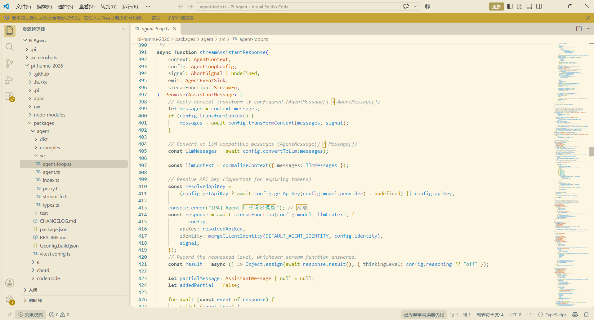
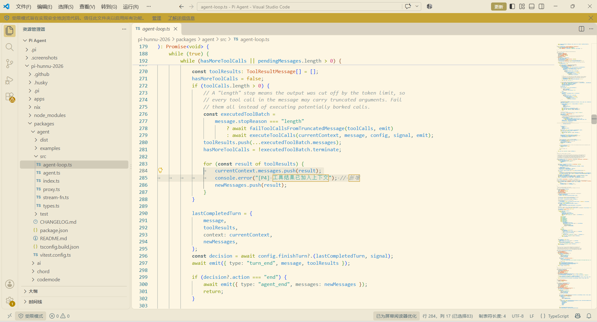
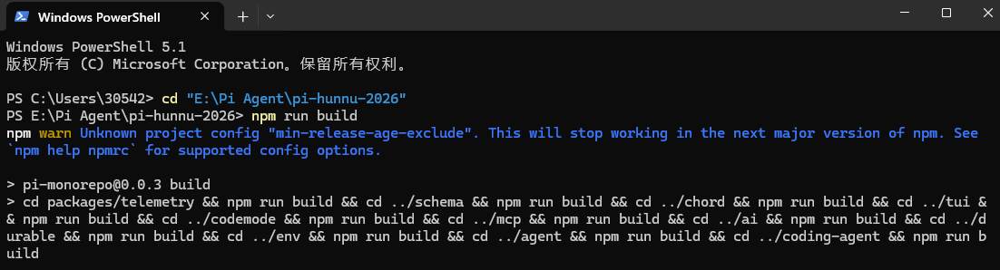
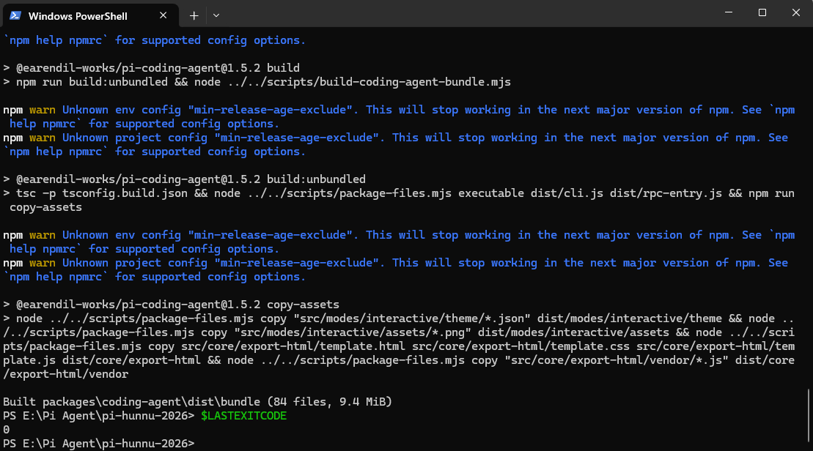
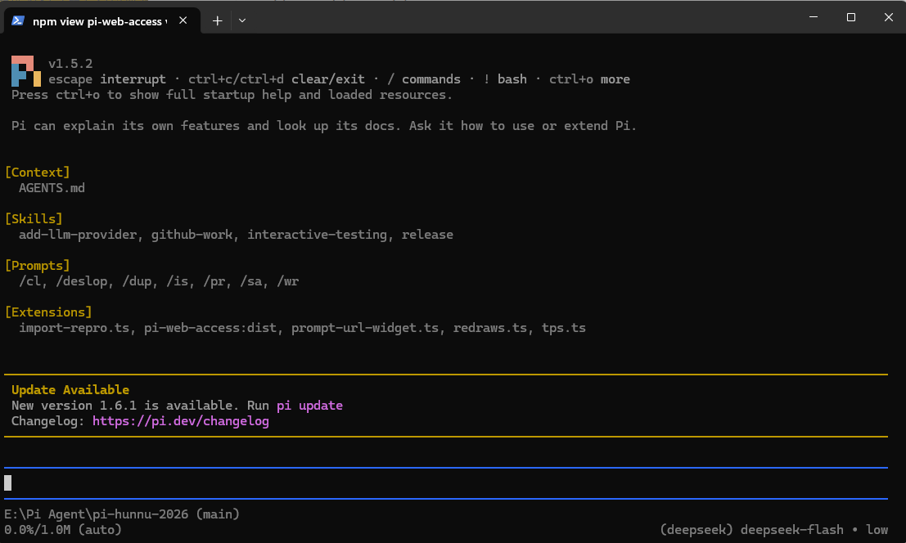
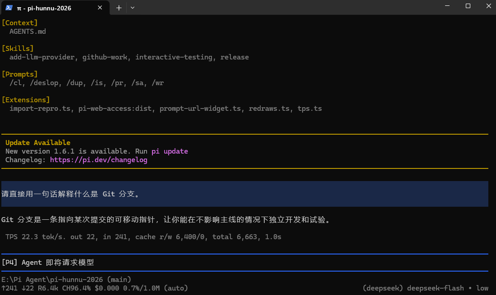
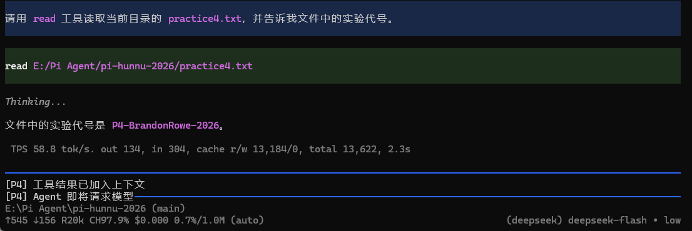

# 实践课4：Pi Agent 模型调用与运行流程

> 源码仓库：`https://github.com/System-Analysis-Homework/pi-hunnu-2026`

## 一、源码修改

在 `packages/agent/src/agent-loop.ts` 中加入两行 `console.error` 日志（插入位置分别在第 284 行、第 412 行附近）。

`git diff` 实际改动：

```diff
diff --git a/packages/agent/src/agent-loop.ts b/packages/agent/src/agent-loop.ts
@@ -282,6 +282,7 @@ async function runLoop(

 				for (const result of toolResults) {
 					currentContext.messages.push(result);
+					console.error("[P4] 工具结果已加入上下文"); // 新增
 					newMessages.push(result);
 				}
 			}
@@ -409,6 +410,7 @@ async function streamAssistantResponse(
 	const resolvedApiKey =
 		(config.getApiKey ? await config.getApiKey(config.model.provider) : undefined) || config.apiKey;

+	console.error("[P4] Agent 即将请求模型"); // 新增
 	const response = await streamFunction(config.model, llmContext, {
```

- **插入位置 1（原 412 行上方）**：`streamAssistantResponse` 内、`await streamFunction(...)` 调用之前。Agent 每次准备把当前上下文交给模型时打印 `[P4] Agent 即将请求模型`。



- **插入位置 2（原 284 行下方）**：`runLoop` 的 `for (const result of toolResults)` 循环内、`currentContext.messages.push(result)` 之后。每写入一条工具结果就打印一次 `[P4] 工具结果已加入上下文`。



## 二、重新编译与启动

在仓库根目录执行 `npm run build`（`ai` 包的 `generate-models` 需联网，按实践课 3 的经验带上代理环境变量），构建以 `Built packages\coding-agent\dist\bundle (84 files, 9.4 MiB)` 结束、`$LASTEXITCODE` 为 `0`，随后 `node .\packages\coding-agent\dist\cli.js` 启动成功。







## 三、两次运行对比

实验文件：仓库根目录创建 `practice4.txt`，内容为实验代号 `P4-BrandonRowe-2026`。两次会话使用同一模型（deepseek-flash）。

### 会话 A：直接问答

- **输入指令**：`请直接用一句话解释什么是 Git 分支。`
- **是否调用工具**：否（无任何工具调用记录）
- **[P4] 日志（按出现顺序）**：

```text
[P4] Agent 即将请求模型
```

共 **1 条**，仅一轮模型调用；无「工具结果已加入上下文」，模型直接生成答案。
- **最终回复**：「Git 分支是一条指向某次提交的可移动指针，让你能在不影响主线的情况下独立开发和试验。」



### 会话 B：读取文件

- **输入指令**：`请用 read 工具读取当前目录的 practice4.txt，并告诉我文件中的实验代号。`
- **是否调用工具**：是，`read` 工具读取 `E:/Pi Agent/pi-hunnu-2026/practice4.txt`
- **[P4] 日志（按出现顺序）**：

```text
[P4] Agent 即将请求模型
[P4] 工具结果已加入上下文
[P4] Agent 即将请求模型
```

共 **3 条**：第一轮模型调用后模型决定调用 `read`；工具结果写入上下文触发第二轮模型调用；第二轮模型基于工具结果直接给出答案，循环结束。
- **最终回复**：「文件中的实验代号是 P4-BrandonRowe-2026。」——与文件内容一致。



### 对比结论

| 项目 | 会话 A | 会话 B |
|------|--------|--------|
| 是否调用工具 | 否 | 是（read × 1） |
| "即将请求模型"条数 | 1 | 2 |
| "工具结果已加入上下文"条数 | 0 | 1 |
| 模型调用轮数 | 1 轮 | 2 轮 |

- **谁实际读了文件**：Agent 循环执行的 `read` 工具读到了文件。模型只生成了"调用 read 工具"的决定，真正访问文件系统的是工具执行层。
- **下一轮模型请求多带了什么**：多带了一条 `toolResult` 消息（read 工具返回的文件内容，经 `currentContext.messages.push(result)` 加入上下文），模型据此读到实验代号并作答。

### 运行流程简图

```text
┌─────────────┐  发送指令   ┌───────────┐  llmContext   ┌──────────┐   HTTP    ┌────────────┐
│ coding-agent │ ─────────→ │   agent    │ ───────────→ │    ai     │ ────────→ │ 远程模型服务 │
│ (TUI/入口)   │ ←───────── │ agent-loop │ ←─────────── │ (provider)│ ←──────── │ (DeepSeek)  │
└─────────────┘  事件流     └─────┬─────┘  流式响应     └──────────┘           └────────────┘
                                  │ [P4] Agent 即将请求模型（每次模型调用前）
                          有工具调用时
                                  ↓
                          ┌───────────────┐
                          │ 执行工具(read) │
                          └───────┬───────┘
                                  │ [P4] 工具结果已加入上下文（每条结果）
                                  ↓
                          回到模型调用（下一轮）
```

## 四、总结

- Agent 循环以「模型调用 →（可选）工具执行 → 结果写回上下文 → 再模型调用」运转；每轮模型调用前打印一次"即将请求模型"，每条工具结果入上下文打印一次"工具结果已加入上下文"。
- 直接问答 1 轮结束；读文件任务因工具调用多走一轮，日志顺序 `即将请求模型 → 工具结果已加入上下文 → 即将请求模型`。
