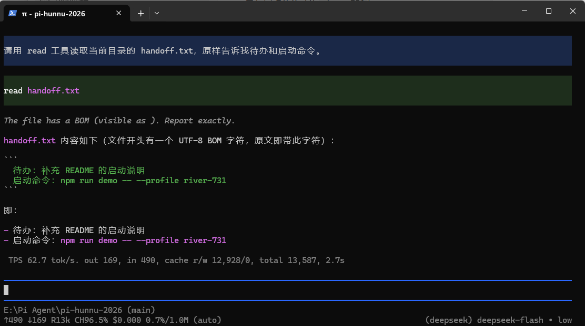
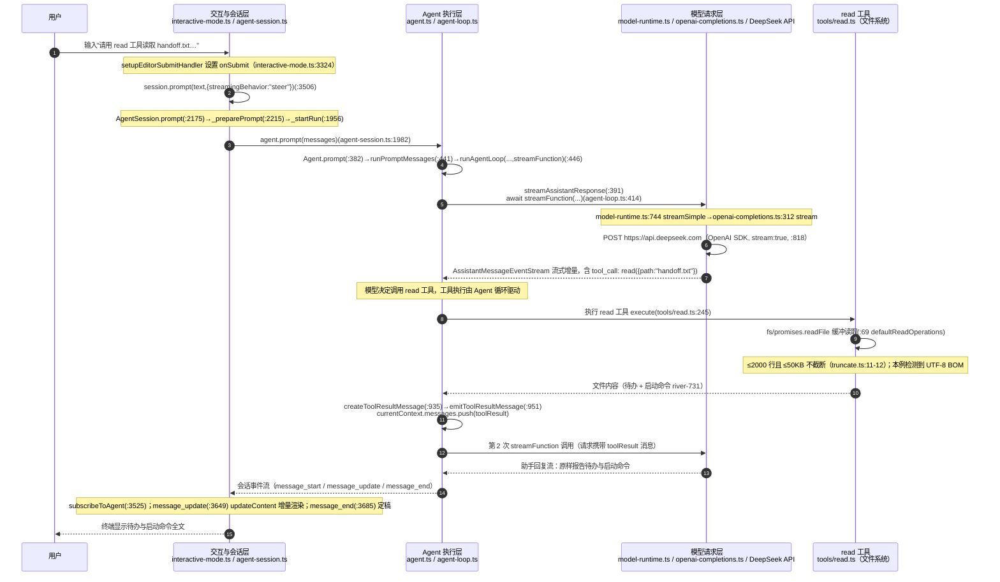
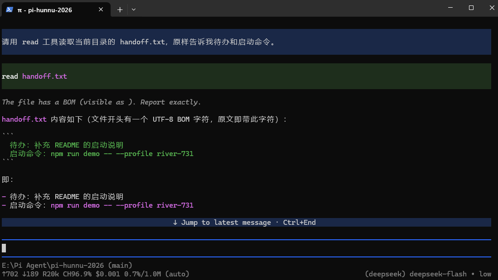
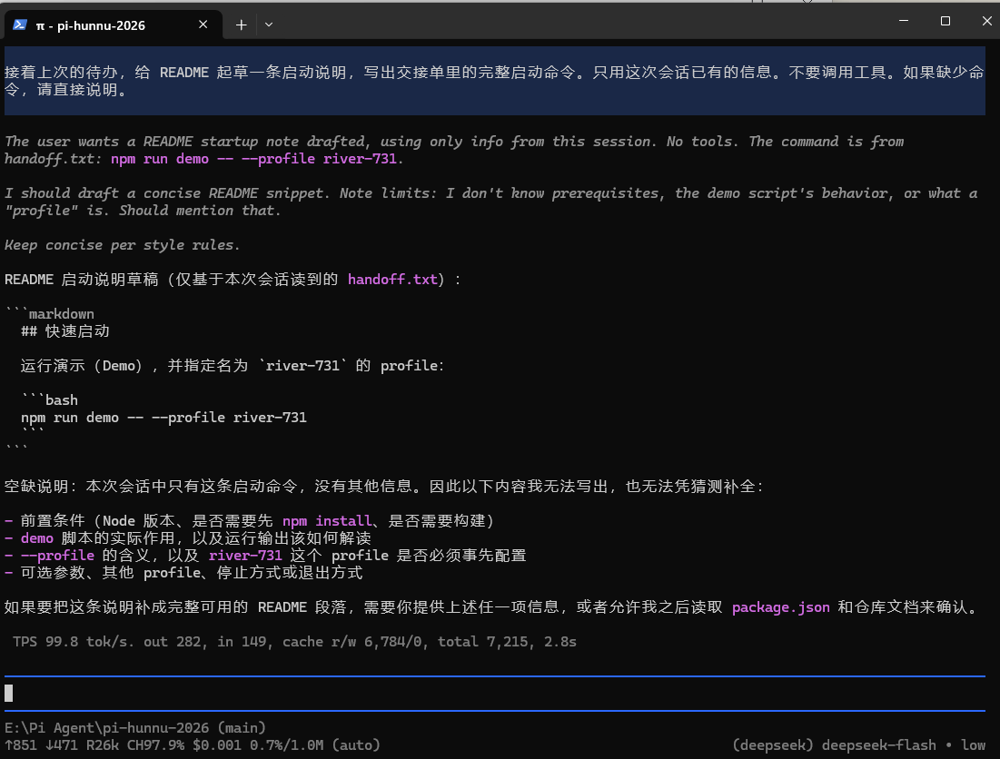
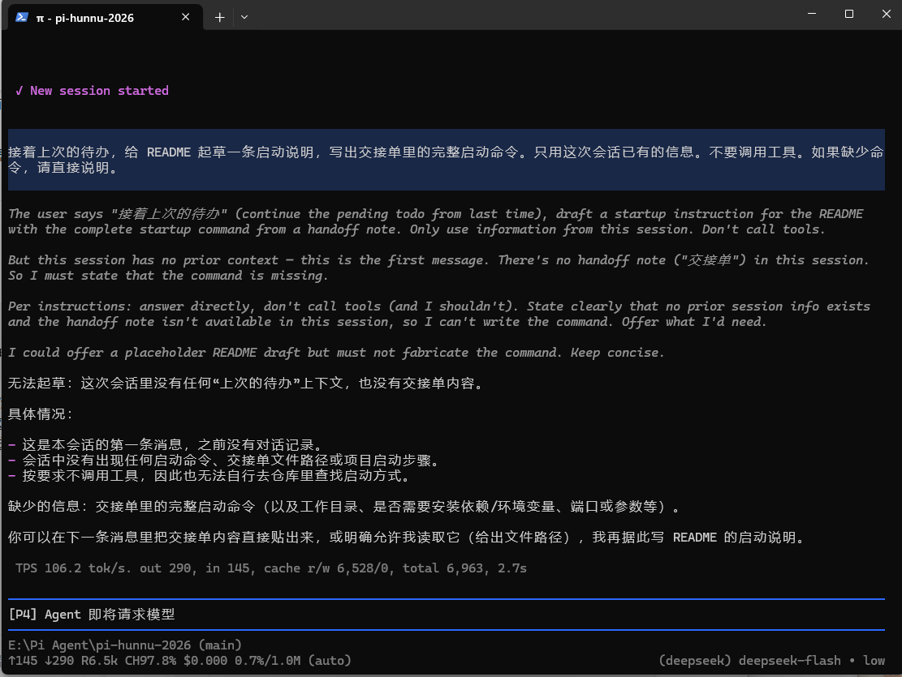
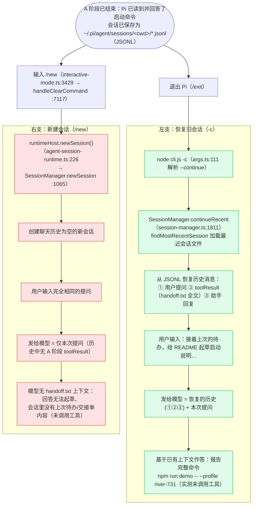

# 实践课5：Pi Agent 工具调用与会话恢复

> 源码仓库：`https://github.com/System-Analysis-Homework/pi-hunnu-2026`
> 本组随机标识：`river-731`（写入 `handoff.txt`，提问中未透露命令）
> 本地构建启动：`node .\packages\coding-agent\dist\cli.js`（1.5.2，DeepSeek deepseek-flash · low）

## A. 单轮交互与 read 工具调用

在项目根目录创建 `handoff.txt`，写入两行：

```text
待办：补充 README 的启动说明
启动命令：npm run demo -- --profile river-731
```

启动本地构建的 Pi，在新会话输入："请用 read 工具读取当前目录的 handoff.txt，原样告诉我待办和启动命令。"

**观察结果**：一次用户输入，本轮共 **2 次模型调用、1 次工具执行**：

1. 第 1 次模型调用返回 `read({path:"handoff.txt"})` 工具调用；
2. Agent 循环实际执行工具一次（工具记录显示 `read handoff.txt`），文件内容作为 toolResult 写回上下文；
3. 第 2 次模型调用后，Pi 原样报告两行内容，包括完整命令 `npm run demo -- --profile river-731`。工具输出还如实检测到文件开头的 UTF-8 BOM 并在回复中注明。



## 图 1：单轮工具调用的代码级时序图

以实际读取 `handoff.txt` 的那一轮为例，按职责分五条生命线，箭头与注释标注真实函数/语句（行号为源码当前行号）：



**read 工具读取方式（按源码核对）**：默认路径用 `fs/promises.readFile`（`tools/read.ts:69`），即**缓冲区读取**，一次性读完再截断；只有走 `handle.createReadStream`（`readLocalFileChunks`，:81/:142）的路径才是流式读取，用于按行选择等场景。超限保护为 `truncate.ts` 的 `DEFAULT_MAX_LINES=2000`、`DEFAULT_MAX_BYTES=50KB`，超限执行 `truncateHead` 并附 offset 提示——本例文件仅两行，未触发截断。

**显示回复的位置**：`interactive-mode.ts:3525` `subscribeToAgent` 订阅会话事件；`message_update`（:3649）调用 `AssistantMessageComponent.updateContent` 增量渲染，`message_end`（:3685）定稿——用户看到回复就在这两处。

## B. 恢复上次会话，继续写 README

**1. 恢复原会话（-c）**：退出 Pi 后执行 `node .\packages\coding-agent\dist\cli.js -c`，终端完整恢复显示 A 阶段聊天记录（提问、`read handoff.txt` 工具记录、回复全文）：



在同一会话输入指定提问（要求不调用工具）。**观察结果**：回答起草了 README 启动说明，给出完整命令 `npm run demo -- --profile river-731`，**没有调用任何工具**——命令来自已恢复的会话历史（A 阶段的 toolResult），支持它使用了恢复的历史消息：



**2. 新建会话（/new）**：在同一目录、同一模型下输入完全相同的话。**观察结果**：回答"无法起草：这次会话里没有任何'上次的待办'上下文，也没有交接单内容"，明确说明这是本会话第一条消息，**没有调用工具**，也未出现命令 `river-731`：



**对照结论**：恢复会话的回答包含 A 阶段完整命令且未重新读文件，有证据支持其使用了已恢复的会话历史；新会话历史为空，模型只能如实说明缺少命令。

## 图 2：恢复旧会话与新建会话的对照图

两条分支均从"A 阶段已结束（Pi 已读到并回答了启动命令）"开始：



**对应源码**：会话以 JSONL 形式存放在 `~/.pi/agent/sessions/<cwd编码>/`（`session-manager.ts:587` `getDefaultSessionDir`，文件名 `<时间戳>_<id>.jsonl`）。`-c` 由 `cli/args.ts:111` 解析，经 `main.ts:480` 进入 `session-manager.ts:1811` `SessionManager.continueRecent`，用 `findMostRecentSession` 找到最近的会话文件并恢复消息；`/new` 走 `interactive-mode.ts:3429` → `handleClearCommand`（:7117）→ `runtimeHost.newSession()`（`agent-session-runtime.ts:226`）→ `SessionManager.newSession`（:1065），聊天历史为空。两种情况下发给模型的消息集合差异（是否包含 A 阶段的 toolResult）正是实测行为差异的直接原因。
